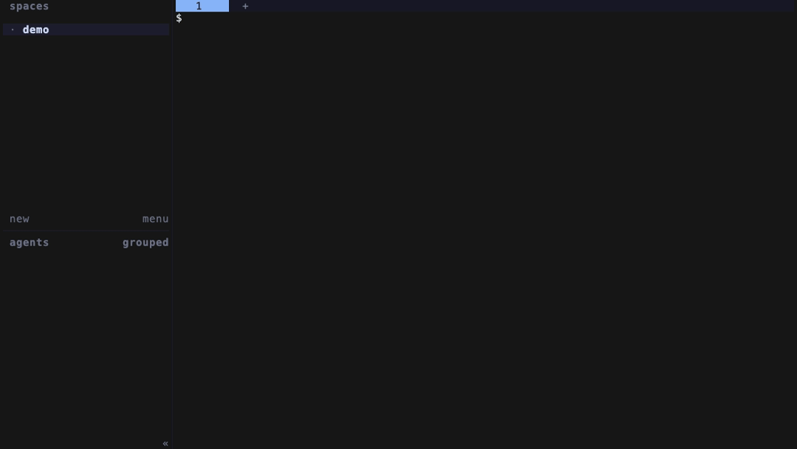

# HerdR Motion

[](https://github.com/carlosiborra/herdr-motion/actions/workflows/ci.yml)
[](https://github.com/carlosiborra/herdr-motion/releases)
[](LICENSE)
[](https://herdr.dev/tui/plugins/)



Smooth split-ratio effects for [HerdR](https://herdr.dev) panes. When a pane opens, closes or the row around it changes, the split eases to its new size instead of jumping.

- **Open.** A new pane slides open from its edge. Split a pane that sits in a row of columns (or a column of rows) and the row evens out as it grows, so three columns end as thirds, not 50 / 25 / 25.
- **Close.** The row or column a pane left shares the space evenly, eased.
- **Move flash (opt in).** Panes that traded places briefly show a `⇄` mark as their title.
- **Styles.** Eight bundled feels (`lively`, `smooth`, `snappy`, `bouncy`, `gentle`, `subtle`, `cinematic`, `instant`) and a visual settings picker.

## What it does not do

- It does not move, restart, or send input to any pane. It only changes split ratios.
- It does not arrange layouts or follow pane counts; it only animates the change you made.
- It does not read pane contents (see [Privacy and trust](#privacy-and-trust)).
- Zoomed tabs are left alone.

## Requirements

HerdR 0.9.5 or newer, Python 3.9 or newer, macOS or Linux. Standard library only.

## Install

```sh
herdr plugin install carlosiborra/herdr-motion
```

The startup hook launches the background worker the next time the HerdR server starts. To start it right away without restarting HerdR, run the plugin's startup command once: `python3 bin/herdr-motion --start` from the plugin directory.

### Keybindings

Add any of these to your HerdR `config.toml`:

```toml
[[keys.command]]
key = "prefix+shift+m"
type = "plugin_action"
command = "carlosiborra.motion.open"      # the settings picker popup

[[keys.command]]
key = "prefix+alt+m"
type = "plugin_action"
command = "carlosiborra.motion.toggle"    # effects on / off

[[keys.command]]
key = "prefix+alt+n"
type = "plugin_action"
command = "carlosiborra.motion.next-style"
```

The plugin binds no keys itself; pick any free keys.

## The settings picker

Run **Motion settings** (`carlosiborra.motion.open`). Styles are on the left; a miniature tab on the right plays the highlighted style on a loop (a pane opens and the row evens out, a pane closes, two panes swap) so you can compare them before choosing. Below the styles are switches for each effect and the speed. Colours follow your HerdR theme.

| Key | Action |
| --- | --- |
| `↑` `↓` (`j` `k`) | Move |
| `Enter` | Choose the highlighted style |
| `Space` | Toggle the highlighted effect |
| `◂` `▸` (`h` `l`) | Change the speed; `0` returns to the style's own speed |
| `e` | All effects on or off |
| `Esc` / `q` | Close |

Choices save instantly; the worker picks them up on its next event.

## Styles

From a shell: list with `bin/herdr-motion --styles`, switch with `--style NAME`, cycle with `--next`.

| Style | Feel |
| --- | --- |
| `lively` | Balanced; new panes land with a small spring (default) |
| `smooth` | Even, unhurried ease, no overshoot |
| `snappy` | Quick and crisp, 130 ms |
| `bouncy` | Pronounced spring on everything |
| `gentle` | Slow start and finish, calm |
| `subtle` | Short; new panes grow only part of the way |
| `cinematic` | 700 ms, long dramatic deceleration |
| `instant` | No animation |

## Settings

`motion.json` in the plugin config directory (`HERDR_PLUGIN_CONFIG_DIR`; `herdr plugin config-dir carlosiborra.motion` prints it). Every key is optional. The style supplies the timing keys; writing one here overrides the style.

| Key | Default | Meaning |
| --- | --- | --- |
| `enabled` | `true` | Master switch (also the `toggle` action) |
| `style` | `lively` | One of the styles above |
| `fps` | `60` | 10 to 60; frames per second while an animation runs |
| `grow`, `rebalance_on_close`, `even_out` | `true` | Turn each effect on or off |
| `flash_moves` | `false` | Opt in: mark swapped panes with a title for a moment |
| `duration_ms` | style | 0 to 1000; 0 jumps without animating |
| `easing`, `grow_easing` | style | `linear`, `out-cubic`, `out-quint`, `out-back`, `spring`, `in-out` |
| `grow_depth` | style | 0 to 1: how far from collapsed a new pane starts |
| `flash_ms`, `flash_mark` | style | How long and with what text a swapped pane is marked |

## The background worker

The `[[startup]]` hook is a one-shot command: `bin/herdr-motion --start` spawns the worker in its own session with its output sent to a log file, then returns immediately. It never stays in the foreground.

| Command | What it does |
| --- | --- |
| `--start` | Launch the worker detached and return (what HerdR runs at startup) |
| `--stop` | Stop the worker and clear any flash titles it set (also the `carlosiborra.motion.stop` action) |
| `--status` | Print JSON: running or stopped, pid, log path, effective settings |

Lifecycle:

- **One worker per HerdR server.** It holds an exclusive lock keyed by the socket path. A second start finds the lock held and exits; a start during a live handoff waits up to 5 seconds for the previous worker to leave.
- **Files** live in `HERDR_PLUGIN_STATE_DIR`: `worker-<id>.lock`, `worker-<id>.pid`, `flashes-<id>.json` and `worker.log` (rotated at 256 KiB). Settings live in `HERDR_PLUGIN_CONFIG_DIR`.
- **It exits on its own** when the event stream closes (the server stopped or restarted), on `SIGTERM`, `SIGINT` or `SIGHUP`, and when HerdR reports the plugin disabled or uninstalled. If the server is not reachable at start it retries for about 3 seconds and exits.
- **Disabled-plugin detection** runs when an event arrives, at most once every 5 seconds, so a worker in a server that has gone completely quiet notices on the next event. `carlosiborra.motion.stop` ends it immediately.

Run outside HerdR (for example from a shell), the paths fall back to `$XDG_CONFIG_HOME/herdr/plugins/config/herdr-motion` (settings), `$XDG_STATE_HOME/herdr/herdr-motion` (state) and `$XDG_CONFIG_HOME/herdr/herdr.sock` (socket), with `~/.config` and `~/.local/state` when the XDG variables are unset. The picker reads the HerdR theme from `HERDR_CONFIG_PATH`, or `$XDG_CONFIG_HOME/herdr/config.toml`.

Why a raw socket: the `herdr` CLI has no generic API call, and the event stream (`events.subscribe`), layout export and ratio writes (`layout.export`, `layout.set_split_ratio`) and pane titles (`pane.report_metadata`) exist only on the newline-delimited JSON socket. The CLI is used for everything it can do (opening the picker popup).

## Performance

- **Event-driven.** The worker blocks on the HerdR event subscription. While nothing animates it has no timers and no wakeups, so it costs nothing when idle.
- **Animations** use a frame timer (at most `fps`) only while they run, then block again.
- **Disabled.** With effects off the worker still reads events but makes no exports or writes.
- **Writes cause redraws.** Each ratio write resizes panes, and programs inside a resized pane get a window-size change (`SIGWINCH`) and may redraw. A 260 ms animation at 60 fps is about 15 such writes per animated split; frames that would change less than a terminal cell are skipped. Use `fps`, a shorter style, or `instant` if that matters for a heavy full-screen program.
- **Latency.** HerdR batches layout events about every 100 ms, so a new pane can appear at its final size for up to that long before the grow starts. Earlier versions polled the focused tab to hide this; that polling was removed.

## Privacy and trust

The worker talks only to HerdR's local Unix socket (`HERDR_SOCKET_PATH`) and makes no network connections. It subscribes to `layout.updated`, `tab.created` and `tab.closed`; asks for `layout.export` and the tab list (pane ids and split ratios); calls `layout.set_split_ratio` to animate; calls `plugin.list` for its own id to notice being disabled; and, only if you enable `flash_moves`, `pane.report_metadata` with its own source name to set and clear a title. It never requests pane output, scrollback or input.

## Update and uninstall

```sh
herdr plugin action invoke carlosiborra.motion.stop     # stop the worker first
herdr plugin update                              # or: herdr plugin uninstall carlosiborra.motion
```

The worker also exits by itself once HerdR reports the plugin disabled or removed, and the next server start launches the new version. Stopping first just makes the swap immediate. Move-flash titles carry a time limit, so none can outlive the worker.

## Development and tests

```sh
python3 -m unittest discover -s tests -t .
```

Standard library only; see [CONTRIBUTING.md](CONTRIBUTING.md). Changes are listed in [CHANGELOG.md](CHANGELOG.md) and security reports go through [SECURITY.md](SECURITY.md).

## License

[MIT](LICENSE)
